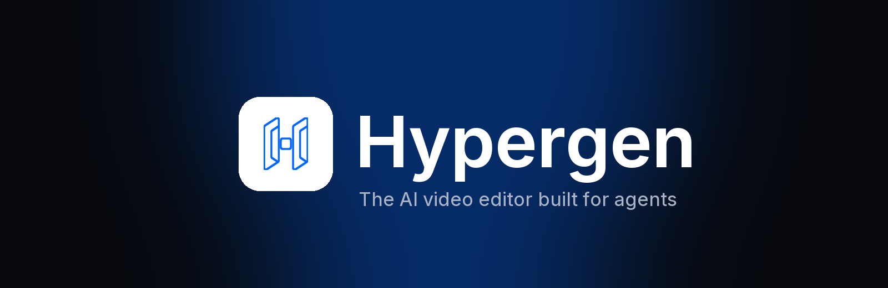

<p align="center">
  
</p>

<p align="center"><b>The AI video editor built for agents.</b><br />Edit video with Claude Code, Codex and your own words — then finish it by hand in a full editor.</p>

<p align="center">
  <a href="https://github.com/buckleson/hypergen/releases/latest">Download</a> ·
  <a href="docs/reference/tools/README.md">Tool reference</a> ·
  <a href="docs/reference/jsx/README.md">JSX reference</a> ·
  <a href="docs/examples/README.md">Examples</a>
</p>

---

## What Hypergen is

Hypergen is a desktop video editor that AI agents can drive. You put your footage in a folder and tell your agent what video you want. The agent cuts, captions, colours, animates and renders it. You can open the same project in the editor and change anything by hand.

Every project is code. Each edit on the canvas or the timeline is written back to the project's JSX source, and each change to the source redraws the canvas. So you and your agent always work on the same version.

## Features

| | |
| --- | --- |
| **Agent editing** | Connects to Claude Code, Codex, Cursor, VS Code Copilot, Gemini CLI, Windsurf, OpenCode and Claude Desktop through the built-in `hypergen` MCP server. |
| **Built-in chat** | A chat panel inside the editor drives your own Claude Code or Codex sign-in. No extra API key is needed. |
| **Timeline editor** | Layers, keyframes, transitions, masks, captions, effects, snapping and full undo. |
| **See and hear media** | Agents probe, grab frames, make filmstrips and waveforms, and transcribe and ask questions about footage. |
| **Local transcription** | Word-level captions with Whisper, running on your computer. No key, no upload. |
| **AI generation** | Images, video, voice, music, background removal and upscaling through your own fal.ai key. |
| **Video questions** | Ask about a clip ("what is said in the intro?") through your own Gemini key. |
| **Segmentation** | Track and cut out objects with SAM 2.1, running locally on the GPU. |
| **Export** | Render MP4 locally. No cloud render. |
| **Private by design** | No account, no telemetry. Your keys are encrypted on your computer. |

## Install

Download the installer for your system from [Releases](https://github.com/buckleson/hypergen/releases/latest):

| System | File |
| --- | --- |
| Windows (x64) | `Hypergen-x64-Setup.exe` |
| macOS (Apple Silicon) | `Hypergen-arm64.dmg` |
| Linux (x64) | `hypergen_*_amd64.deb` or the `.zip` |

The builds are not code-signed yet:

- **Windows:** at the SmartScreen warning, click **More info** → **Run anyway**.
- **macOS:** right-click the app and click **Open** the first time.

## Connect your agent

1. Open Hypergen.
2. Open **Settings → MCP & CLI**. Under **Agents**, turn on the switch next to your agent. Hypergen adds its `hypergen` MCP server to that agent's configuration.
3. Restart the agent. It shows the `hypergen` tools (`mcp__hypergen__*`).
4. Ask for the video you want, in plain language.

To use the `hypergen` command in a terminal, click **Install** under **CLI** on the same page.

## Add your AI provider keys (optional)

Editing, transcription, segmentation and export work with no key. Two features use a key that you supply:

| Feature | Provider | Get a key |
| --- | --- | --- |
| Generate images, video, voice, music; remove backgrounds; upscale | fal.ai | <https://fal.ai/dashboard/keys> |
| Ask questions about video and audio (`listen`) | Google Gemini | <https://aistudio.google.com/apikey> |

Add them in **Settings → AI providers**. Hypergen encrypts the keys with your operating system's key store. They never leave your computer except in the requests to that provider.

## Prompt examples

```text
Edit the footage in ~/Videos/trip into a 60-second highlight video with music and captions.
```

```text
Turn this interview into a vertical 30-second clip for social media. Remove filler words and add bold captions.
```

```text
Create a 20-second animated product promo for our app, with a title card, three feature callouts and an end card.
```

```text
List the three main topics in this talk with timestamps.
```

## The command line

Each MCP tool is also a `hypergen` command. Every result is one JSON object.

```sh
hypergen open ~/Projects/promo                     # open (or create) a project folder
hypergen probe clip.mp4                            # container and codec metadata
hypergen grab clip.mp4 -t 0 12 45                  # frames as PNGs
hypergen filmstrip clip.mp4                        # a grid of frames
hypergen waveform track.mp3                        # audio waveform, silences flagged
hypergen transcribe interview.wav                  # word-level transcript (local Whisper)
hypergen listen interview.mp4 -p "what is said in the intro?"   # needs a Gemini key
hypergen capture intro -t 0 2 4                    # frames as an export would render them
```

See the [tool reference](docs/reference/tools/README.md) for every command and option.

## Compositions as code

A project is a folder with a JSX entry file. The root is a `<stage>` with one `<scene>` per frame size:

```tsx
export default function Project() {
  return (
    <stage>
      <scene name="Intro" width={1920} height={1080} fill="black" active>
        <video src="footage/city.mp4" start={0} end={5} width={1920} height={1080} />
        <text width={1920} height={1080} textAlign="center" textBaseline="middle"
              fontSize={128} color="#FFFFFF" start={0} end={2.5}>
          Hypergen
        </text>
      </scene>
    </stage>
  );
}
```

See the [JSX reference](docs/reference/jsx/README.md) and the [examples](docs/examples/README.md).

## Build from source

Requirements: Node 20+ and npm.

```sh
git clone https://github.com/buckleson/hypergen.git
cd hypergen
npm install
npm run dev          # start the desktop app in development mode
```

Other commands:

```sh
npm run check        # typecheck all workspaces
npm run lint         # lint
npm test             # tests
npm run make --workspace=@hypergen/desktop   # build installers for this OS
npm run brand        # regenerate icons and images from scripts/brand
```

### Repository layout

| Path | What it is |
| --- | --- |
| `apps/web` | The editor UI (SolidJS + Vite) |
| `apps/desktop` | The Electron app: MCP server, CLI install, agent chat host |
| `apps/cli` | The `hypergen` command-line client |
| `packages/runtime` | Headless editor runtime (ECS, media decoding, capture) |
| `packages/reconciler` | Mounts a project's JSX onto the runtime |
| `packages/jsx` | The composition elements and types |
| `packages/assets` | The project asset library |
| `packages/encoder` | Video, audio and image encoding |
| `packages/agent-chat` | The chat panel host for Claude Code and Codex |
| `packages/sam2` | Local SAM 2.1 segmentation |

### Continue the development work

The `.workspace/` folder holds the project plans, the decision records, the hand-off log and the agent definitions. Start with [`.workspace/README.md`](.workspace/README.md).

## License

[MPL-2.0](LICENSE).

## Credits

Secured by HyperOx · Powered by [Buckleson](https://buckleson.com) · Managed by [Pavi](https://pavi.tech)
